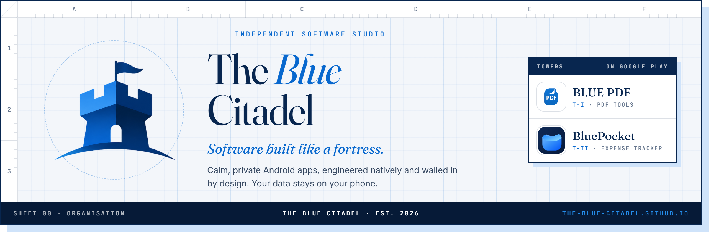

  
  
  

**The Blue Citadel** is an independent software studio making calm, private Android apps. Every app is planned,
designed and built in-house, from the interface down to native C++ where speed matters.

A citadel is the strongest, innermost part of a fortress: the place where what matters most is kept safe. That is
the job these apps do for your files and your money. **Your data stays inside the citadel: on your phone.**

## The towers

<table>
  <tr>
    <td width="50%" valign="top">
      
      <h3>BLUE PDF</h3>
      
<em>Fast, private PDF tools for Android.</em>

      
Merge, split, reorder, protect and create PDFs on your phone, powered by the native MuPDF engine.

      <ul>
        <li>Ships without the internet permission</li>
        <li>Native C++ engine, smooth on 300+ page files</li>
        <li>AES-256 password protection</li>
        <li>Open source under AGPL-3.0</li>
      </ul>
      

        <a href="https://play.google.com/store/apps/details?id=com.bluepdf.blue_pdf"><b>Google Play</b></a> ·
        <a href="https://github.com/The-Blue-Citadel/blue_pdf">Source</a> ·
        <a href="https://the-blue-citadel.github.io/apps/blue-pdf/">About</a> ·
        <a href="https://the-blue-citadel.github.io/privacy/blue-pdf/">Privacy policy</a>
      

    </td>
    <td width="50%" valign="top">
      
      <h3>BluePocket</h3>
      
<em>A calm, offline-first expense tracker.</em>

      
Log what you spend and receive in a couple of taps, with a ledger that stays on your phone.

      <ul>
        <li>Works fully offline, stored on-device</li>
        <li>Optional bank-text import, off by default</li>
        <li>Shared Groups when you want them</li>
        <li>No ads, nothing sold</li>
      </ul>
      

        <a href="https://play.google.com/store/apps/details?id=com.thebluecompany.bluepocket"><b>Google Play</b></a> ·
        <a href="https://the-blue-citadel.github.io/apps/bluepocket/">About</a> ·
        <a href="https://the-blue-citadel.github.io/privacy/bluepocket/">Privacy policy</a>
      

    </td>
  </tr>
</table>

## Four walls around your data

<table>
  <tr>
    <td width="50%" valign="top"><b>01 · On-device first</b> Files and ledgers are processed and stored on your phone. The cloud is used only where a feature truly needs it, and only when you opt in.</td>
    <td width="50%" valign="top"><b>02 · No ads, no trackers</b> No advertising SDKs, no analytics, no profiling. The apps are built to earn trust, not impressions.</td>
  </tr>
  <tr>
    <td width="50%" valign="top"><b>03 · Least permission</b> Each app asks only for what it needs, when it needs it. BLUE PDF does not even request access to the internet.</td>
    <td width="50%" valign="top"><b>04 · Policies in plain words</b> Every <a href="https://the-blue-citadel.github.io/privacy/">privacy policy</a> is short, specific and public, written to be read rather than simply agreed to.</td>
  </tr>
</table>

## Built with

  
  
  
  
  
  
  

## Write to the citadel

Questions, feedback, bug reports or privacy requests: **[payushman72@gmail.com](mailto:payushman72@gmail.com)**.
Every message is read by a person.

Designed, engineered and maintained by Ayushman Pal · Est. 2026
